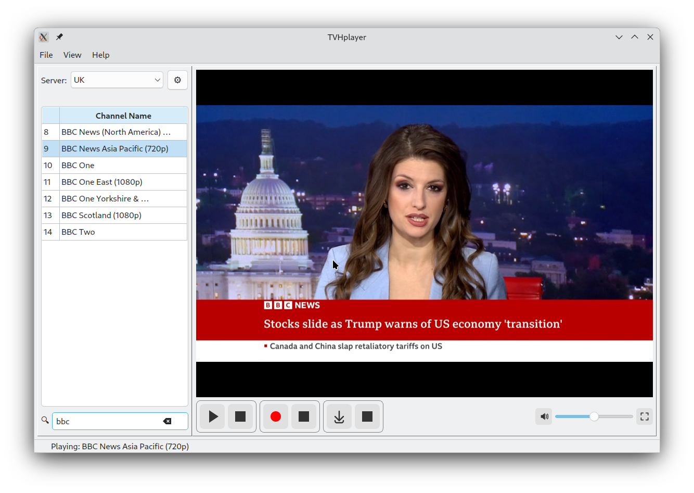

<a href='https://flathub.org/apps/io.github.mfat.tvhplayer'>
    
  </a>

# TVHplayer
A desktop app for watching and recording live TV, with its own built-in Tvheadend server or any Tvheadend server you already have.



## Features

**Watch**
- Live TV and radio from one or more Tvheadend servers
- Sound tracks, DVB and teletext subtitles, and deinterlacing from the Playback menu
- Fullscreen with on-screen controls and messages
- Says why a channel will not start, in the server's own words, and shows a tuner's reception while it starts

**Built-in server (Linux)**
- Comes with its own Tvheadend that starts and stops with the app, so no separate server is needed
- **Set Up Channels** finds your tuners (USB, PCIe, SAT>IP and HDHomeRun) and scans for channels
- Add internet TV from M3U playlists, pick the groups and channels you want, and hide the ones that do not work
- TV guide for internet channels from XMLTV guides, found for your channels or added by address or file

**TV guide**
- Every channel against time in one window, with watch and record from the guide
- Channel logos from the server, or from the picons project for channels without one

**Record**
- Record on the server, now or scheduled from the guide
- Record on this computer, several channels at once, as MPEG-TS, MP4 or Matroska
- Convert recordings into edit-friendly MP4 files
- Warns about scheduled recordings that need more tuners than the server has
- Keeps the computer awake while recording or with a recording coming up

**Channel list**
- Choose the columns: number, now and next with a progress bar, type, and status
- Groups, favourites, search, and channel editing (rename, renumber, hide) saved on the server
- Stays quick with lists of hundreds of thousands of channels

**Look and access**
- TVHplayer's own theme in light and dark, or any Qt style on your computer
- Keyboard shortcuts for everything (F1 lists them) and screen reader support

## Download
- **Flatpak** from [Flathub](https://flathub.org/apps/io.github.mfat.tvhplayer)
- **deb** (Debian, Ubuntu) and **rpm** (Fedora) packages for x86_64 and arm64 from [Releases](https://github.com/mfat/tvhplayer/releases)
- **macOS and Windows** builds from [Releases](https://github.com/mfat/tvhplayer/releases). These connect to an existing Tvheadend server; the built-in server is part of the Linux packages only.

The Flatpak, deb and rpm include the built-in server, VLC, mpv and ffmpeg, or pull them in as dependencies.

## Getting started
- **Built-in server**: on first start with no channels, TVHplayer opens **Set Up Channels**. Choose a TV tuner or an IPTV playlist and follow the steps.
- **Your own server**: click the gear button (Manage servers) above the channel list, choose **Add Server…**, and enter the server's address with `http://` and the port (usually `http://server:9981`), plus your username and password. HTSP is the default and gets channel and recording changes as they happen.

See the [User Guide](https://github.com/mfat/tvhplayer/wiki/User-Guide) (Help → User Guide) for everything else.

## Help and support
- [Open a bug report](https://github.com/mfat/tvhplayer/issues/new)
- Help → Open Log Folder shows the app's log (`app.log`) and the built-in server's log (`tvheadend.log`). Please attach them to bug reports.

## Run from source
You need Python 3, VLC, ffmpeg and, on Wayland, libmpv.

```bash
git clone https://github.com/mfat/tvhplayer.git
cd tvhplayer
python3 -m pip install -r requirements.txt
python3 tvhplayer/tvhplayer.py
```

To use the built-in server from a checkout, build Tvheadend in a checkout next to this one, so the binary is at `../tvheadend/build.linux/tvheadend`, or copy it to `build/tvheadend`. See [docs/tvheadend-source.md](docs/tvheadend-source.md) for the Tvheadend version the packages use.

Run the tests with `python3 -m pytest tests`.

## Technical information
- Talks to Tvheadend over HTSP or its HTTP JSON API
- Plays with libmpv on Wayland and libvlc on X11, macOS and Windows; choose under Settings → Playback → Playback engine
- Records and converts with ffmpeg
- Built with PyQt6

## Support development
Bitcoin: `bc1qqtsyf0ft85zshsnw25jgsxnqy45rfa867zqk4t`

Doge:  `DRzNb8DycFD65H6oHNLuzyTzY1S5avPHHx`
