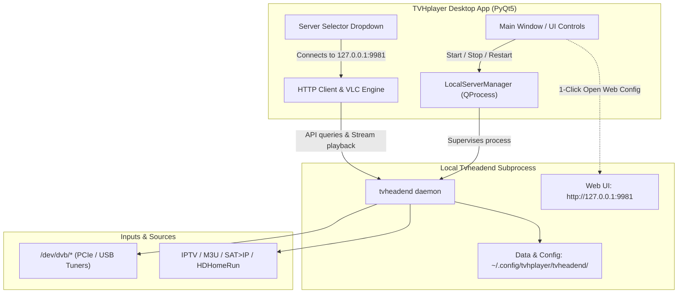

# Proposal & Evaluation Plan: Integrated Local Tvheadend Server

- **Status:** Proposed / Under Evaluation
- **Target Project:** [TVHplayer](file:///home/mahdi/GitHub/tvhplayer)
- **Target Backend:** [Tvheadend](file:///home/mahdi/GitHub/tvheadend)
- **Date:** October 2026

---

## 1. Executive Summary

TVHplayer is currently designed as a standalone desktop client that connects to existing external or remote Tvheadend servers (or raw M3U streams). While this model works well for home lab or NAS setups, mainstream desktop users without an existing Tvheadend infrastructure face a significant onboarding barrier when attempting to use local TV tuners (DVB-T/T2/S/C, ATSC, HDHomeRun) or IPTV playlists managed by a backend tuner daemon.

This proposal outlines the design, technical evaluation, and step-by-step implementation plan for enabling TVHplayer to supervise and run a **local, self-contained Tvheadend server instance**.

### Core Goals
1. **Zero-Setup Out-of-the-Box:** Allow users on Linux to launch TVHplayer and immediately use local tuners and IPTV without manually setting up a separate system daemon.
2. **Process Lifecycle Management:** Ensure TVHplayer cleanly starts, monitors, and terminates the local Tvheadend process without zombie processes, port leaks, or data corruption.
3. **Isolated Configuration:** Store all Tvheadend configurations, logs, and channel databases within TVHplayer's configuration space (`~/.config/tvhplayer/tvheadend`), avoiding interference with system-wide installations (`/etc/tvheadend` or `~/.hts/tvheadend`).
4. **Security by Default:** Restrict the local daemon to `127.0.0.1` and secure/streamline authentication for local IPC.
5. **Seamless UI Integration:** Provide a local server control panel (start/stop/restart, port config, log viewer, and a 1-click "Open Web UI" button for tuner tuning).

---

## 2. Architecture Overview



---

## 3. Evaluation of Binary Delivery Options

| Strategy | Technical Mechanism | Advantages | Disadvantages / Challenges | Recommendation |
| :--- | :--- | :--- | :--- | :--- |
| **Option 1: Pluggable Executable Path (Local / System)** | App looks for `tvheadend` in order:<br>1. Configured custom path<br>2. App-relative `bin/tvheadend`<br>3. System `$PATH` (`/usr/bin/tvheadend`) | • Zero packaging friction during development<br>• Directly leverages existing `/home/mahdi/GitHub/tvheadend/build.linux/tvheadend`<br>• Works with distro packages (`apt install tvheadend`) | • Requires users without Flatpak to have tvheadend installed or built | **Adopt immediately for Phase 1** (Testing & Development) |
| **Option 2: Bundled inside Flatpak** | Add a build module in [io.github.mfat.tvhplayer.yml](file:///home/mahdi/GitHub/tvhplayer/io.github.mfat.tvhplayer.yml) with `--enable-bundle` to embed Web UI & DVB scan tables into the binary. | • Complete out-of-the-box experience for Flathub users<br>• Flatpak already defines `--device=all`, allowing access to `/dev/dvb/*` and `/dev/dri/*` hardware acceleration | • Increases Flatpak build time and manifest complexity<br>• Need to vendor build dependencies in the manifest | **Adopt for Phase 3** (Flathub & Packaging Release) |
| **Option 3: Containerized Daemon (Docker / Podman)** | TVHplayer invokes Docker/Podman CLI or socket to run `linuxserver/tvheadend` or custom container. | • Clean environment isolation<br>• Cross-platform compatibility on Windows (WSL2) and macOS | • Heavy dependency on Docker/Podman engine<br>• Complex device forwarding (`--device /dev/dvb`)<br>• Difficult to orchestrate securely from inside Flatpak sandbox | Not recommended as primary solution |
| **Option 4: Systemd User Service Integration** | TVHplayer controls a user-level service (`systemctl --user start tvheadend`). | • Daemon lifecycle can outlive UI if background recordings are scheduled | • Linux/systemd specific<br>• Flatpak sandbox restrictions (`flatpak-spawn --host`)<br>• Complicated setup for non-technical users | Optional future enhancement |

---

## 4. Technical Specification for Local Server Execution

### 4.1 Invocation Command & Arguments

Tvheadend must be invoked in foreground mode (without `-f`) so that `QProcess` or `subprocess.Popen` retains direct process control:

```bash
tvheadend \
  -c ~/.config/tvhplayer/tvheadend \
  -B \
  -C \
  --bindaddr 127.0.0.1 \
  --http_port 9981 \
  --htsp_port 9982 \
  --noacl \
  --nostderr \
  --logfile ~/.config/tvhplayer/tvheadend/tvheadend.log
```

#### Argument Breakdown:
- **`-c <dir>`**: Alternate configuration path. Ensures TVHplayer owns its configuration independently of any system `/etc/tvheadend` or default `~/.hts/tvheadend`.
- **`-B, --nobackup`**: Disables auto-backup archive generation during startup/upgrades to conserve disk space.
- **`-C, --firstrun`**: Automatically initialises administrative access without an interactive terminal prompt when no user account exists.
- **`--noacl`**: Bypasses authentication checks for requests originating from localhost.
- **`--bindaddr 127.0.0.1`**: **Security safeguard.** Prevents external network interfaces from accessing the server, ensuring that unauthenticated access (`--noacl`) is exclusively accessible by local processes.
- **`--http_port 9981` / `--htsp_port 9982`**: Explicit ports (configurable in TVHplayer settings if defaults conflict).
- **`--logfile <path>`**: Directs all daemon logging to a predictable file for debugging and in-app log viewer display.

### 4.2 Configuration Directory Layout

```text
~/.config/tvhplayer/
├── tvhplayer.conf             # TVHplayer client settings
└── tvheadend/                 # Local Tvheadend root directory (-c)
    ├── tvheadend.log          # Subprocess logs
    ├── config                 # Core daemon configuration
    ├── input/                 # DVB and IPTV adapter configurations
    │   ├── dvb/               # Hardware adapter muxes & networks
    │   └── iptv/              # IPTV network configs
    ├── channeltags/           # Tags and channel groupings
    ├── channel/               # Configured channels
    └── dvr/                   # Scheduled recording configurations
```

---

## 5. TVHplayer Integration Design

### 5.1 Process Supervisor (`LocalServerManager`)

A dedicated manager implemented in Python (using `QProcess` for native Qt event-loop integration):

```python
class LocalServerManager(QObject):
    status_changed = pyqtSignal(str)       # "stopped", "starting", "running", "error"
    log_received = pyqtSignal(str)         # Real-time stdout/stderr lines

    def __init__(self, binary_path=None, config_dir=None, http_port=9981, htsp_port=9982):
        super().__init__()
        self.binary_path = binary_path or self.find_binary()
        self.config_dir = config_dir or self.default_config_dir()
        self.http_port = http_port
        self.htsp_port = htsp_port
        self.process = QProcess()
        self.process.readyReadStandardError.connect(self._on_stderr)
        self.process.readyReadStandardOutput.connect(self._on_stdout)
        self.process.finished.connect(self._on_finished)

    def start_server(self) -> bool:
        """Starts the tvheadend process and polls until /api/serverinfo responds."""
        ...

    def stop_server(self, timeout_ms=5000):
        """Sends SIGTERM, waits up to timeout, then terminates forcefully if needed."""
        ...

    def is_running(self) -> bool:
        """Checks if process is active and HTTP port responds."""
        ...
```

### 5.2 Application Lifecycle Hooks

1. **Startup (`tvhplayer.py:__init__`)**:
   - Check if `local_server_enabled` is `True` in `tvhplayer.conf`.
   - If enabled, start `LocalServerManager`.
   - If default server is `"Local Server (Built-in)"`, wait asynchronously for HTTP ready check before fetching channel lists.
2. **Shutdown (`tvhplayer.py:closeEvent`)**:
   - If the local server was started by TVHplayer, trigger `LocalServerManager.stop_server()`.
   - Wait up to 3–5 seconds for graceful database sync and process exit before closing the Qt main window.

### 5.3 UI Components

1. **Server Dropdown**:
   - Pre-populate a permanent entry: `"Local Server (Built-in)"` pointing to `http://127.0.0.1:9981`.
2. **Local Server Management Dialog**:
   - Status indicator widget (🟢 Running | 🔴 Stopped | 🟡 Initialising).
   - Action buttons: `[Start Server]`, `[Stop Server]`, `[Restart]`.
   - `[Open Web Interface]`: Launches default browser to `http://127.0.0.1:<port>` for initial tuner scanning and channel mapping.
   - Server Settings: Binary path picker, HTTP port, HTSP port, and Auto-start toggle.
   - Built-in Log Viewer: Displays tail of `tvheadend.log` with a `[Refresh]` / `[Clear]` button.

---

## 6. Permissions and Hardware Access

- **DVB Hardware (`/dev/dvb/*`)**:
  - The local user running TVHplayer must have read/write access to DVB tuner nodes. On most Linux distributions (Ubuntu, Debian, Fedora, Arch), this requires membership in the `video` group:
    ```bash
    sudo usermod -aG video $USER
    ```
  - TVHplayer should detect missing permissions and present a helpful diagnostic warning dialog if `/dev/dvb` exists but is inaccessible.
- **Hardware Acceleration (`/dev/dri/*`)**:
  - For transcoding (VAAPI / QSV / NVENC), access to the `render` group is required.
- **Flatpak Sandbox**:
  - The existing manifest [io.github.mfat.tvhplayer.yml](file:///home/mahdi/GitHub/tvhplayer/io.github.mfat.tvhplayer.yml) already includes `--device=all`, `--share=network`, and `--share=ipc`, satisfying all hardware and networking requirements within the sandbox.

---

## 7. Phased Implementation Plan


### Phase 1: Local Binary Support & Verification (Development)
- [x] Verify Tvheadend build configuration options with `--enable-bundle`.
- [ ] Compile `/home/mahdi/GitHub/tvheadend` into `build.linux/tvheadend`.
- [ ] Test headless launch with `--bindaddr 127.0.0.1 -c ~/.config/tvhplayer/tvheadend -C --noacl`.
- [ ] Verify that TVHplayer can connect, query `/api/serverinfo`, and play streams from the local instance.

### Phase 2: UI & Supervisor Integration
- [ ] Implement `LocalServerManager` class in `tvhplayer/local_server.py`.
- [ ] Wire up lifecycle hooks in `closeEvent` and startup in [tvhplayer.py](file:///home/mahdi/GitHub/tvhplayer/tvhplayer/tvhplayer.py).
- [ ] Add "Local Server Settings" dialog with status, start/stop buttons, port configuration, and log viewer.
- [ ] Add "Open Web UI" button to quickly launch `http://127.0.0.1:9981`.

### Phase 3: Flatpak Packaging
- [ ] Add `tvheadend` module to [io.github.mfat.tvhplayer.yml](file:///home/mahdi/GitHub/tvhplayer/io.github.mfat.tvhplayer.yml).
- [ ] Verify build flags (`--enable-bundle`, `--disable-ffmpeg_static` or reuse Flatpak ffmpeg).
- [ ] Confirm Flatpak build succeeds and launches both `tvhplayer` and `/app/bin/tvheadend`.

### Phase 4: First-Run Wizard & Diagnostics
- [ ] Provide initial setup wizard when local server is selected for the first time.
- [ ] Add automated diagnostic check for `/dev/dvb` permissions and port conflicts.
